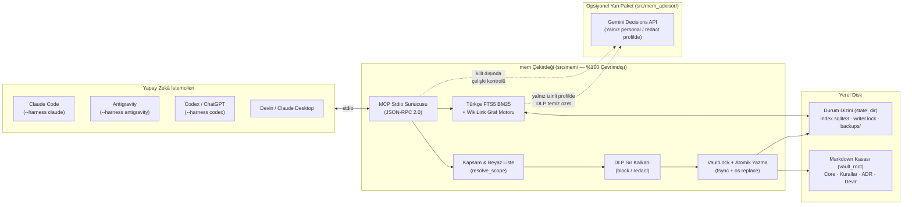
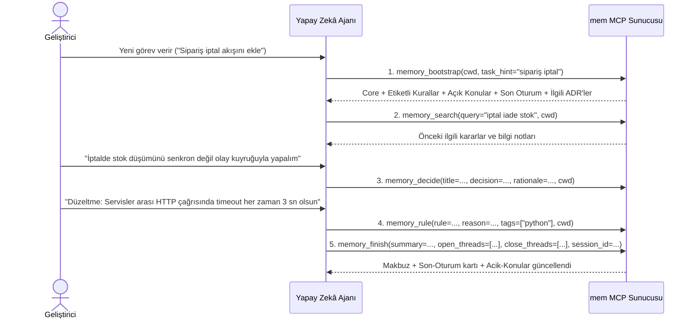

# mem — Yapay Zekâ Ajanları İçin Yerel İkinci Beyin (MCP) Motoru

**`mem`**, yapay zekâ kodlama ajanları ve masaüstü asistanları için geliştirilmiş **sıfır harici bağımlılıklı**, **yerel öncelikli (local-first)**, **çok ajanlı eşzamanlılığa dayanıklı** ve **Obsidian uyumlu** bir mühendislik hafızası motorudur.

Projelerinizde alınan mimari kararları (**ADR**), kullanıcı düzeltmelerinden doğan kalıcı kuralları, oturumlar arası devir özetlerini ve açık iş kalemlerini doğrudan bilgisayarınızdaki **düz Markdown (`.md`)** dosyalarında saklar; **Model Context Protocol (MCP)** üzerinden kullandığınız tüm yapay zekâ araçlarının (**Claude Code, Claude Desktop, OpenAI Codex / ChatGPT, Google Antigravity, Devin**) tek ve tutarlı bir hafızayı paylaşmasını sağlar.

---

## İçindekiler

1. [Neden `mem`? Hangi Problemleri Çözer?](#1-neden-mem-hangi-problemleri-çözer)
2. [Temel Tasarım İlkeleri](#2-temel-tasarım-ilkeleri)
3. [Nasıl Çalışır? (Derinlemesine Mimari)](#3-nasıl-çalışır-derinlemesine-mimari)
4. [Adım Adım Kurulum Rehberi](#4-adım-adım-kurulum-rehberi)
5. [Günlük Kullanım Akışı (Yaşam Döngüsü)](#5-günlük-kullanım-akışı-yaşam-döngüsü)
6. [MCP Araçları ve Prompt'lar (Tam Referans)](#6-mcp-araçları-ve-promptlar-tam-referans)
7. [Komut Satırı (CLI) Tam Referansı](#7-komut-satırı-cli-tam-referansı)
8. [Güvenlik Modeli ve Hassas Veri Kalkanı (DLP)](#8-güvenlik-modeli-ve-hassas-veri-kalkanı-dlp)
9. [Opsiyonel: Gemini Decisions Danışmanı (`personal` Profil)](#9-opsiyonel-gemini-decisions-danışmanı-personal-profil)
10. [Kasa Yapısı, Obsidian Uyumu ve Bakım (`compact` & Git Yedeği)](#10-kasa-yapısı-obsidian-uyumu-ve-bakım-compact--git-yedeği)
11. [Ortam Değişkenleri ve Veri Dizinleri](#11-ortam-değişkenleri-ve-veri-dizinleri)
12. [Bilinen Sınırlar ve Sorun Giderme (SSS)](#12-bilinen-sınırlar-ve-sorun-giderme-sss)
13. [Test Paketi ve Katkı](#13-test-paketi-ve-katkı)

---

## 1. Neden `mem`? Hangi Problemleri Çözer?

Modern yazılım geliştirmede tek bir yapay zekâ aracı veya tek bir sohbet penceresi kullanılmıyor; aynı gün içinde bir araçta mimari planlama yapılırken diğerinde kod yazılıyor, bir başkasında test ve inceleme yürütülüyor. Bu çalışma biçimi beş temel soruna yol açar:

### 1.1. Oturumlar ve Araçlar Arası Hafıza Kaybı (Bağlam Amnezisi)
Her yeni sohbet sıfır hafızayla başlar. Projenizin kurallarını, kodlama standartlarını, dün gece yarım kalan işleri ve dikkat edilmesi gereken tuzakları her seferinde farklı araçlara tekrar anlatmak hem zaman hem de ciddi token kotası yakar. `mem`, oturum başında tek bir `memory_bootstrap` çağrısıyla kimliğinizi, kurallarınızı, son oturum devir kartını ve açık konuları ajana otomatik yükler.

### 1.2. "Buna Neden Böyle Karar Vermiştik?" Erozyonu
Bir projede haftalar önce somut bir nedenle reddedilmiş bir mimari yaklaşım (örneğin *"Neden WebSocket yerine SSE seçildi?"* veya *"Neden bu uçta önbellek kapalı?"*), bağlamı bilmeyen yeni bir ajan tarafından tekrar "iyileştirme" diye önerilebilir. `mem`, kararları gerekçesi ve alternatifleriyle birlikte **ADR (Architecture Decision Record)** olarak kaydeder; bir karar değiştiğinde eski kararı silmek yerine `supersedes` (yerine geçme) bağıyla tarihçeyi korur ve aramalarda yalnızca yürürlükteki kararı öne çıkarır.

### 1.3. Manuel Not Tutma Yükü ("Notion Mezarlığı" Sorunu)
Geliştiriciler kod yazarken ayrıca bir dokümantasyon aracına geçip düzenli not tutmakta zorlanır; klasör yapıları karmaşıklaştıkça not sistemi terk edilir. **`mem`'de notları insan değil, işi yapan ajanlar yazar.** Siz normal şekilde çalışırsınız; ajanlar karar alındığında ADR yazar, onları düzelttiğinizde kalıcı kural ekler, iş bittiğinde devir kartını bırakır. Siz yalnızca istediğinizde klasörü Obsidian veya herhangi bir editörde açıp okursunuz.

### 1.4. Kurumsal Güvenlik, EDR/DLP ve Bulut Gizliliği Engeli
Pek çok "AI hafıza" aracı; kaynak kodunuzu dış bulut sunucularına gönderir, arka planda sürekli çalışan servisler (daemon) kurar, gizli kabuk betikleri çalıştırır ya da onlarca üçüncü parti Python/C++ bağımlılığı (`pip install`) gerektirir. Kurumsal iş bilgisayarlarında bu araçlar EDR/DLP güvenlik yazılımlarına takılır veya şirket verisini dışarı sızdırma riski taşır.
- **`mem` çekirdeği (`src/mem/`) %100 çevrimdışıdır:** İçinde tek bir ağ modülü (`http`, `urllib`, `socket`, `ssl`) veya alt süreç (`subprocess`) çağrısı dahi bulunmaz; yalnızca Python 3.11+ standart kütüphanesiyle çalışır.

### 1.5. Çok Ajanlı Çalışmada Birbirini Ezen Notlar (Yarış Koşulları)
Aynı projede aynı anda hem bir planlama ajanı (ör. Claude) hem bir uygulama ajanı (ör. Antigravity veya Codex) çalıştığında düz dosyaya yazan basit sistemler birbirinin açık konularını ve notlarını ezer. `mem`; işletim sistemi dosya kilitleri, atomik dosya değişimi, `sha256` iyimser kilitleme ve **ajan (`harness`) bazlı açık konu sahipliği** ile çok ajanlı yarış koşullarını güvenli biçimde yönetir.

---

## 2. Temel Tasarım İlkeleri

| İlke | Uygulama Biçimi |
|---|---|
| **Tek Doğruluk Kaynağı = Markdown** | Tüm bilgi insan tarafından okunabilir düz `.md` dosyalarındadır. SQLite veritabanı (`index.sqlite3`) yalnızca hız için tutulan türetilmiş bir yan indekstir; silinse bile saniyeler içinde Markdown dosyalarından birebir yeniden kurulur. |
| **Sıfır Harici Bağımlılık** | Sanal ortam (`venv`), `pip install`, Docker veya harici veritabanı sunucusu gerektirmez. Python 3.11+ kurulu her makinede doğrudan `python mem.py` ile çalışır. |
| **Sıfır Arka Plan Servisi** | Sistem açılışına yerleşen gizli bir daemon yoktur. MCP sunucusu yalnızca IDE/asistan açıkken standart girdi/çıktı (`stdio`) üzerinden konuşur ve istemci kapandığında sonlanır. |
| **Önce Beyaz Liste (`projects.json`)** | Kayıtlı olmayan bir klasörde (`cwd`) açılan ajan kasadan tek bir karakter bile okuyamaz ve kasaya hiçbir şey yazamaz (`status: unregistered_workspace`). |
| **Varsayılan Açık Sır Kalkanı (DLP)** | API anahtarları, JWT'ler, özel anahtarlar (`PEM`/`PGP`), veritabanı bağlantı dizeleri, TCKN ve IBAN verileri diske inmeden önce yakalanır (`work` profilinde yazma reddedilir, `personal` profilinde maskelenir). |
| **Kasa ve Durum İzolasyonu** | İndeks (`index.sqlite3`), kilit (`writer.lock`) ve otomatik yedekler (`backups/`) her zaman Markdown kasasının **dışında** tutulur; Git veya Obsidian senkronizasyonunu kirletmez. |

---

## 3. Nasıl Çalışır? (Derinlemesine Mimari)



### 3.1. Kapsam ve Proje Beyaz Listesi (`config.py` & `vault.py`)
Her MCP çağrısı aktif çalışma alanı yolunu (`cwd`) gönderir. `mem`, bu yolu `norm_path` (`realpath` + küçük harf normalizasyonu) ile çözer ve `projects.json` içindeki kayıtlı proje kökleriyle karşılaştırır:
- İç içe (monorepo) dizinlerde **en uzun eşleşen kök dizin** kazanır.
- Çalışma alanı beyaz listede değilse anında `unregistered_workspace` döner; hiçbir kasa verisi dışarı sızmaz.
- Bir projede çalışan ajan başka bir projenin özel notlarını okuyamaz ve yamayamaz (`projects/<diğer>/...` erişimi reddedilir); yalnızca kendi projesine ve `knowledge/` altındaki ortak bilgi notlarına erişebilir.

### 3.2. Artımlı İndeksleme ve Başlık Duyarlı Pasajlama (`store.py`)
Arama veya `bootstrap` çağrıldığında `sync_vault` çalışır:
1. Kasa içindeki `.md` dosyalarının `(mtime_ns, size_bytes)` değerlerini `documents` tablosuyla karşılaştırır. Değişmemiş dosyalar diskten **hiç okunmaz** (750+ notluk bir kasada senkronizasyon milisaniyeler sürer). Sembolik linkler ve `.git`, `.obsidian`, `node_modules` dizinleri güvenlik gereği atlanır.
2. Yeni veya değişmiş dosyalar kod bloklarını (` ``` ` / ` ~~~ `) ortadan bölmeden, Markdown başlık hiyerarşisini (`Servis Mimarisi > Önbellek > TTL`) koruyarak ~900 karakterlik anlamlı pasajlara (`passages`) ayrılır.
3. Gövdedeki tüm `[[WikiLink]]` bağlantıları `links` tablosuna, karar geçersiz kılma ilişkileri `supersedes` tablosuna işlenir.

### 3.3. Türkçe Kök/Ek Duyarlı Arama ve Graf Sıralaması (`turkish.py` & `search.py`)
Standart tam metin arama motorları Türkçe sondan eklemeli kelimelerde başarısız olur (`"önbellek"` notunu `"önbellekteki"` veya `"önbelleklerimizden"` sorgusuyla bulamaz). `mem` bunu harici kütüphane kullanmadan çift katmanlı indekslemeyle çözer:
- **Çift Katmanlı FTS5:** Pasajın orijinal metni `unicode61` ile indekslenirken, `shadow_terms` sütununa Türkçe karakterleri katlanmış (`ğ→g, ü→u, ş→s, ı→i, ö→o, ç→c`) ve yaygın çekim/iyelik/hal ekleri kontrollü olarak soyulmuş gölge kökler yazılır (`bağlantılarından` → `baglant`). Minimum kök uzunluğu koruması sayesinde `PostgreSQL`, `OAuth2`, `Redis` gibi teknik terimler bozulmaz.
- **Çok Katmanlı Puanlama:**
  1. FTS5 BM25 ağırlıkları: `başlık (8.0) > başlık_yolu (4.0) > gövde (2.0) > gölge_kök (1.5)`.
  2. Aktif projeye ait belgelere `×1.25` proje çarpanı; `decision` ve `rule` belgelerine `×1.15` öncelik çarpanı; ham oturum makbuzlarına (`receipt`) gürültüyü azaltmak için `×0.65` ağırlık uygulanır.
  3. **1-Hop `[[WikiLink]]` Graf Yakınlığı:** En yüksek puanlı ilk 3 sonuca doğrudan `[[WikiLink]]` ile bağlı olan komşu notlara `+0.10 × tepe_puan` bağlam bonusu verilir.

### 3.4. `bootstrap` Bağlam Bütçesi ve Taban Pay Algoritması (`vault.py`)
`memory_bootstrap` çağrıldığında ajanın bağlam penceresini şişirmeden en kritik bilgileri sırasıyla birleştirir:
1. **Zorunlu Katman (Asla Kırpılmaz):** `Core.md` + proje etiketlerine (`tags`) göre filtrelenmiş `Kurallar.md` + `projects/<slug>/Kurallar.md`. Eşleşmeyen etiketli genel kurallar tam metin yerine tek satırlık bir bilgi notuna indirilir.
2. **Garantili Devir Katmanı (`Açık konular` → `Son oturum`):** Oturum devri, arama ipucundan daha kritiktir. Zorunlu kurallar `budget_chars` (varsayılan `8000`) sınırını doldursa veya aşsa bile `Açık konular` ve `Son oturum` bölümlerinin her birine **en az 1.200 karakter kaynak içerik taban payı** garanti edilir ve bütçe aşımı varsa çıktıya açık bir uyarı notu düşülür.
3. **Görev İpucu Katmanı (`İlgili notlar`):** `task_hint` verilmişse makbuzlar dışlanarak (`decision`, `rule`, `knowledge`, `note`, `overview`) en ilgili 4 not kalan bütçeye sığdığı ölçüde eklenir.

### 3.5. Çok Ajanlı `Acik-Konular.md` Sahipliği ve Serbest Metin Korunumu
Gerçek projelerde `Acik-Konular.md` hem insan/mimari notlarını (alt başlıklar, düz maddeler, paragraflar) hem de ajanların takip ettiği `- [ ]` görev kutularını barındırabilir:
- **Sıfır Satır Kaybı:** `- [ ]` görev kutuları dışındaki tüm başlıklar, paragraflar, düz maddeler (`- **Not:** ...`), tamamlanmış `- [x]` satırları ve kod blokları (` ``` `) karakteri karakterine korunur; ajan görevleri bu serbest metnin altında `## Ajan Açık Konuları` başlığı altında yönetilir.
- **Ajan (`harness`) Sahipliği:** Her görev `- [ ] Görev metni <!-- t:a1b2c3 h:claude -->` biçiminde 6 haneli deterministik kimlik ve onu oluşturan istemci (`h:claude`, `h:antigravity`, `h:codex`, `h:devin`) etiketiyle saklanır. Önceden kalma etiketsiz maddeler otomatik olarak `h:legacy` sahibine atanır.
- **Güvenli Birleştirme (`merge`) ve Çapraz Kapatma (`close_threads`):**
  - Varsayılan `threads_mode='merge'` modunda `claude` ajanı `open_threads=["Yeni iş"]` gönderdiğinde yalnızca `h:claude` maddeleri güncellenir (listeden düşen eski `h:claude` maddeleri kayıpsız olarak `archive/YYYY-MM.md`'ye taşınır); `h:antigravity`, `h:codex` ve `h:legacy` maddelerine **dokunulmaz**.
  - Bir ajanın açtığı işi başka bir ajan tamamladığında `close_threads=["t:a1b2c3"]` (veya maddenin tam metni) ile maddeyi kapatıp arşive taşıyabilir.
  - Değişiklik olmayan çağrılarda dosya yeniden yazılmaz; gereksiz yedek ve Git farkı oluşmaz.

### 3.6. Eşzamanlılık, Atomik Yazma ve Kurtarılabilirlik (`lock.py`)
- Yazma işlemleri `state_dir/writer.lock` üzerinde işletim sistemi kilidi (`msvcrt` / `fcntl`) alır; harici danışman ağ çağrıları diğer ajanları bloklamamak için **kilit dışında** yürütülür ve kilit tekrar alındığında çift-`supersedes` (TOCTOU) ile DLP kontrolleri yeniden doğrulanır.
- Dosyalar doğrudan hedef üzerine yazılmaz; aynı dizinde geçici dosyaya yazılıp `os.fsync` ile diske indirildikten sonra `os.replace` ile atomik olarak değiştirilir.
- Değişen her dosyanın önceki hali `state_dir/backups/` altında zaman damgalı `.bak` olarak saklanır (dosya başına son 20 sürüm otomatik rotasyonla tutulur).

---

## 4. Adım Adım Kurulum Rehberi

### 4.1. Gereksinimler ve İndirme
- **Python 3.11 veya üzeri** (Windows, macOS veya Linux; standart SQLite FTS5 desteğiyle gelir).
- Harici paket kurulumu (`pip install`) **gerekmez**.

```bash
git clone https://github.com/tastutanemre/Memory.git
cd Memory
```

### 4.2. Kasa ve Profil Oluşturma (`init`)

Kullanım senaryonuza göre iki temel profil yaklaşımı vardır (aynı makinede ikisini birden ayrı kasalarla kullanabilirsiniz):

#### Seçenek A: Kişisel Bilgisayar (`personal` profili — önerilen)
Hassas verileri otomatik maskeler (`dlp: redact`) ve istenirse kişisel danışman entegrasyonuna izin verir:

```powershell
# Windows (PowerShell)
python mem.py init --profile personal --vault C:\Users\<Kullanici>\MemVault\personal
```
```bash
# macOS / Linux
python3 mem.py init --profile personal --vault ~/MemVault/personal
```

#### Seçenek B: Kurumsal / İş Bilgisayarı (`work` profili — hava boşluklu)
Hassas veri yakalandığında yazmayı tamamen reddeder (`dlp: block`) ve her türlü harici danışman çağrısını kesin olarak kapatır:

```powershell
python mem.py init --profile work --vault C:\Users\<Kullanici>\MemVault\work
```

> **Önemli Kurulum Notları:**
> - `--profile` belirtilmezse güvenlik gereği varsayılan profil `work` (`dlp: block`) olarak açılır.
> - `--vault` belirtilmezse kasa otomatik olarak `~/MemVault/<profil>` altında oluşturulur. **Kasayı `Memory` kod reposunun içine kurmayın;** her zaman repo dışında bağımsız bir dizin seçin.
> - `Core.md` dosyasını bir kez açıp kendinizi, çalışma tarzınızı ve ajanlardan kalıcı beklentilerinizi (ör. *"Kısa cevap ver"*, *"Hatalı fikrime doğrudan itiraz et"*) yazmanız tüm ajanların davranış kalitesini doğrudan yükseltir.

### 4.3. Projelerinizi Beyaz Listeye Ekleyin (`project add`)

Hafızanın aktif olmasını istediğiniz her yazılım projesini kaydedin:

```bash
# Tek kök dizinli ve etiketli proje kaydı
python mem.py --profile personal project add order-service \
  --root /dev/repos/order-service \
  --name "Order Service" \
  --description "Sipariş ve stok mikroservisi" \
  --tag python --tag fastapi

# Birden fazla klasörü (ör. web + mobil) aynı projeye bağlama
python mem.py --profile personal project add commerce-app \
  --root /dev/repos/commerce-web \
  --root /dev/repos/commerce-mobile \
  --name "Commerce App" \
  --tag typescript --tag react-native

# Kayıtlı projeleri görüntüleme
python mem.py --profile personal project list
```

### 4.4. Yapay Zekâ Araçlarına Bağlayın (`connect`)

Kullandığınız tüm araçlar için `connect` komutunu çalıştırın. Bu komut mevcut ayarlarınızı bozmaz, ilk değişiklikten önce `.bak` yedeği alır ve her araca kendi `--harness <ad>` kimliğini yazar:

```bash
python mem.py connect claude --profile personal
python mem.py connect claude-desktop --profile personal
python mem.py connect codex --profile personal
python mem.py connect antigravity --profile personal
python mem.py connect devin --profile personal
```

| Hedef (`harness`) | Yazılan MCP Yapılandırması | Yazılan Global Kural Bloğu | Açıklama |
|---|---|---|---|
| `claude` | `~/.claude.json` | `~/.claude/CLAUDE.md` | Claude Code CLI ve IDE eklentisi |
| `claude-desktop` | `claude_desktop_config.json` *(AppData / MSIX / macOS Application Support)* | — | Masaüstü sohbet için `--vault-scope` ile bağlanır |
| `codex` | `~/.codex/config.toml` | `~/.codex/AGENTS.md` | OpenAI Codex CLI ve ChatGPT/Codex Desktop |
| `antigravity` | `~/.gemini/config/mcp_config.json` | `~/.gemini/config/GEMINI.md` | Google Antigravity IDE |
| `devin` | `%APPDATA%\devin\mcp_config.json` *(POSIX: `~/.config/devin/mcp_config.json`)* | `.../devin/AGENTS.md` | Devin Desktop |

- **Önizleme ve Kaldırma:** Dosyalara dokunmadan ne değişeceğini görmek için `--dry-run`, yalnızca `mem` kayıtlarını temiz biçimde kaldırmak için `--uninstall` ekleyin.
- **Skill Dosyası:** İsteğe bağlı olarak `skills/memory/SKILL.md` dosyasını aracınızın global `skills/memory/SKILL.md` klasörüne kopyalayabilirsiniz.
- **İstemci Yeniden Başlatma:** `connect` çalıştırdıktan sonra açık olan IDE/masaüstü istemcilerini (Windows'ta sistem tepsisinde çalışan Claude Desktop dahil) bir kez yeniden başlatın.

### 4.5. Kurulumu Doğrulayın (`doctor`)

```bash
python mem.py doctor --profile personal
```

`doctor` komutu; Python sürümünü, SQLite FTS5 desteğini, kasa dizinini, `.mem-vault.json` ve DLP kalkanını, `state_dir` izolasyonunu, yazar kilidini, FTS5 indeks bütünlüğünü, kayıtlı proje köklerinin varlığını ve proje bazında **bootstrap zorunlu kural bütçesini** tek seferde denetler.

---

## 5. Günlük Kullanım Akışı (Yaşam Döngüsü)

Kurulumdan sonra günlük kullanımda sizin özel bir komut yazmanıza gerek yoktur; bağlanan global kural bloğu sayesinde ajanlar aşağıdaki döngüyü kendiliğinden yürütür:



### Siz Doğrudan Neler Yapabilirsiniz?
- **Sorular Sorun:** Herhangi bir araçta *"Ödeme servisinde neden iki aşamalı onay seçmiştik?"* veya *"Geçen oturumda hangi açık konular kalmıştı?"* diye sorun; ajan hafızadan kanıtıyla yanıtlar.
- **Obsidian'da Açın:** Kasa klasörünü doğrudan Obsidian'da bir Vault olarak açın. Hazır gelen `.obsidian/graph.json` sayesinde tüm projelerinizi, mimari karar ağınızı ve ortak bilgi notlarınızı renk kodlu bir bilgi grafiği olarak izleyebilirsiniz.
- **Elle Not Ekleyin / Düzenleyin:** `knowledge/` veya `projects/<slug>/` altına istediğiniz `.md` dosyasını elle ekleyebilirsiniz; bir sonraki `memory_bootstrap` veya `memory_search` çağrısında otomatik indekslenir.

---

## 6. MCP Araçları ve Prompt'lar (Tam Referans)

Tüm araçlar kapsam doğrulaması için `cwd` (aktif çalışma alanı yolu) ve isteğe bağlı `project` (proje slug doğrulaması) parametrelerini kabul eder.

### `memory_bootstrap`
Oturum başında bağlamı yükler.
- **Parametreler:** `cwd` *(zorunlu, `--vault-scope` hariç)*, `task_hint` *(string)*, `budget_chars` *(int, `500..50000`, varsayılan `8000`)*, `project` *(string)*.
- **Davranış:** Zorunlu kurallar asla kesilmez; `Açık konular` ve `Son oturum` bölümleri her biri en az `1200` karakter taban pay alır (bu nedenle zorunlu kurallar büyükse toplam metin `budget_chars` değerini ~`2400+` karakter aşabilir). Kayıtsız dizinde `status: unregistered_workspace` döner.

### `memory_search`
Türkçe kök/ek duyarlı FTS5 BM25 + `[[WikiLink]]` graf yakınlığıyla arama yapar.
- **Parametreler:** `query` *(zorunlu)*, `cwd`, `limit` *(int, `1..30`, varsayılan `8`)*, `include_superseded` *(bool, varsayılan `false`)*, `include_archived` *(bool, varsayılan `false`)*, `project`.
- **Davranış:** Proje kapsamında arama yapılırken başka projelerin notları ve projesiz (`project: null`) ham makbuzlar sonuçlara sızmaz; ortak `knowledge/` notları dahil edilir.

### `memory_read`
Belirtilen notun tam içeriğini, ayrıştırılmış frontmatter bilgisini ve güncel `sha256` özetini döndürür.
- **Parametreler:** `path` *(zorunlu, kasa içi göreli yol)*, `cwd`, `project`.

### `memory_decide`
Mimari veya ürün kararını `projects/<slug>/kararlar/YYYY-MM-DD-<baslik>.md` (veya `shared=true` ise `knowledge/kararlar/`) altına ADR olarak yazar ve proje merkez dosyasındaki `[[WikiLink]]` indeksini günceller.
- **Parametreler:** `title` *(zorunlu)*, `decision` *(zorunlu)*, `cwd`, `context`, `alternatives`, `rationale`, `supersedes` *(string listesi — eski ADR yolları veya dosya adları)*, `sources` *(string listesi)*, `tags` *(string listesi)*, `shared` *(bool)*, `force` *(bool)*.
- **Uyarı Kapıları:**
  - Benzer aktif bir karar zaten varsa yazmaz ve `status: "duplicate_warning"` döndürür.
  - Opsiyonel danışman açıksa ve karar önceki bir ADR ile çelişiyor veya henüz kesinleşmemiş ("belki/düşünüyoruz") görünüyorsa `status: "advisor_warning"` döndürür.
  - Eski kararın yerine geçmek için `supersedes` verilir (zaten geçersiz kılınmış bir karar tekrar `supersedes` yapılamaz); kullanıcı onayıyla uyarıyı aşmak için `force=true` kullanılır.

### `memory_rule`
Kullanıcı düzeltmesinden çıkan kalıcı kuralları ekler, günceller veya kaldırır.
- **Parametreler:** `rule` *(zorunlu)*, `cwd`, `reason` *(gerekçe)*, `scope` *(`'global'` veya proje slug'ı)*, `tags` *(string listesi — ör. `["android", "gradle"]`)*, `supersedes` *(değiştirilecek eski kural metni)*, `remove` *(bool — `true` ise eşleşen kuralı kaldırır)*.
- **Davranış:** Mükerrer kuralları engeller (`status: "duplicate"`). `supersedes` veya `remove=true` kullanıldığında eski kural silinmeden önce kayıpsız ve idempotent biçimde `archive/YYYY-MM.md` dosyasına arşivlenir; böylece `Kurallar.md` şişmez.

### `memory_patch`
Mevcut bir notu `sha256` iyimser kilidiyle cerrahi olarak günceller.
- **Parametreler:** `path` *(zorunlu)*, `expected_sha256` *(zorunlu)*, `edits` *(zorunlu, `[{"old": "...", "new": "..."}]`)*, `cwd`, `project`.
- **Davranış:** Dosya başka bir ajan tarafından değiştirilmişse `ConcurrencyConflictError` döner. Her `old` metni dosyada tam olarak **1 kez** geçmelidir.

### `memory_finish`
Anlamlı bir iş tamamlandığında oturum makbuzu (`receipts/YYYY-MM/<hash>.md`), `Son-Oturum.md` devir kartı (son 3–5 kart aktif tutulur, eskiler `archive/YYYY-MM.md`'ye kayar) ve `Acik-Konular.md` güncellemesini tek atomik işlemde yapar.
- **Parametreler:** `summary` *(zorunlu)*, `cwd`, `open_threads` *(string listesi)*, `close_threads` *(string listesi — `t:<id>` veya tam metin)*, `threads_mode` *(`'merge'` varsayılan | `'replace'`)*, `refs` *(string listesi)*, `session_id` *(string)*, `harness` *(string — sunucuda `--harness` yapılandırılmışsa sunucu kimliği her zaman önceliklidir)*.
- **Atomik Ön Doğrulama:** `close_threads` içinde belirsiz (birden fazla maddeyle eşleşen) bir seçici varsa hiçbir makbuz, oturum kartı veya arşiv yazılmadan önce `VaultError` döner.

### Hazır MCP Prompt'ları
`prompts/list` ve `prompts/get` destekleyen istemcilerde (ör. Devin `/mcp__mem__*`, Claude):
- **`start`** (`task`): Oturumu `memory_bootstrap` ile başlatır.
- **`decide`** (`title`): Alınan kararı mükerrer kontrolü yaparak ADR olarak kaydeder.
- **`wrapup`** (`summary`): Oturumu `memory_finish` ile kapatır.

---

## 7. Komut Satırı (CLI) Tam Referansı

Tüm alt komutlar `--profile <ad>`, `--vault <yol>` ve makine okunur çıktı için `--json` bayraklarını destekler:

```bash
# Kasa ve profil yönetimi
python mem.py init --profile personal --vault ~/MemVault/personal [--dlp redact|block] [--advisor off|gemini]
python mem.py profiles
python mem.py doctor --profile personal

# Proje beyaz listesi
python mem.py project add order-service --root /dev/order-service --name "Order Service" --tag python
python mem.py project list

# Bağlam, arama ve okuma
python mem.py bootstrap --cwd /dev/order-service --task "ödeme iadesi" --budget 8000
python mem.py search --cwd /dev/order-service "önbellek kararları" --limit 10 [--include-superseded] [--include-archived]
python mem.py read --cwd /dev/order-service projects/order-service/Order-Service.md

# Karar (ADR), kural ve yama yazma
python mem.py decide --cwd /dev/order-service --title "Önbellek katmanı" --decision "Redis kullanılacak" --rationale "Düşük gecikme"
python mem.py decide --cwd /dev/order-service --shared --title "API sürümleme" --decision "Tüm servisler /v1/ öneki kullanır"
python mem.py rule "Her şema değişikliği geri alınabilir migrasyon içermeli" --scope global --reason "Canlı güvenlik" --tag python
python mem.py rule "Tüm API uçları şema doğrulaması kullanmalı" --scope global --supersedes "Her şema değişikliği geri alınabilir migrasyon içermeli"
python mem.py rule "Eski geçici kural" --scope global --remove
python mem.py patch projects/order-service/Order-Service.md --cwd /dev/order-service --sha256 <mevcut_sha256> --old "eski" --new "yeni"

# Oturum kapatma ve bakım
python mem.py finish --cwd /dev/order-service --summary "İade akışı tamamlandı" --thread "Yük testi yapılacak" --close-thread t:a1b2c3 --session oturum-01 --harness cli
python mem.py compact --profile personal --days 14 [--project order-service] [--dry-run]
python mem.py sync --profile personal

# Araç bağlama, eski kasa aktarımı ve MCP sunucusu
python mem.py connect <claude|claude-desktop|codex|antigravity|devin> --profile personal [--advisor off|gemini] [--dry-run] [--uninstall]
python mem.py import-v3 /eski/kasa/yolu --profile personal [--dry-run]
python mem.py mcp --profile personal --harness claude [--vault-scope] [--advisor off|gemini]
```

### CLI Çıkış Kodları (Exit Codes)

| Kod | Anlamı |
|---|---|
| `0` | İşlem başarılı |
| `1` | `doctor` sağlık denetiminde `FAIL` bulgusu var |
| `2` | Kullanım, doğrulama, yol güvenliği (`PathTraversalError`) veya kilit zaman aşımı hatası |
| `3` | DLP engeli (`DLPBlockedError` — `block` modunda hassas veri yakalandı) |
| `4` | Eşzamanlı değişiklik çakışması (`ConcurrencyConflictError` — `sha256` uyuşmazlığı) |
| `5` | Kayıtsız çalışma alanı (`unregistered_workspace`) |

---

## 8. Güvenlik Modeli ve Hassas Veri Kalkanı (DLP)

### 8.1. Otomatik Yakalanan Hassas Veri Kategorileri (`dlp.py`)
1. **`api_token`:** GitHub (`ghp_`, `gho_`, `github_pat_`), OpenAI/Anthropic (`sk-`), Google (`AIza`), AWS (`AKIA`, `ASIA`), HuggingFace (`hf_`), Slack (`xox...`), Stripe (`sk_live_`, `rk_live_`), npm (`npm_`), SendGrid (`SG.`), Discord token'ları, HashiCorp Vault (`hvs.`) ve Azure SAS imzaları.
2. **`private_key`:** Tam veya yarıda kesilmiş `-----BEGIN ... PRIVATE KEY-----` (`RSA`, `EC`, `OPENSSH`, `PGP`) blokları.
3. **`jwt_bearer`:** Standart 3 parçalı JWT ve 5 parçalı JWE (`eyJ...`) dizeleri, `Authorization:`, `Bearer ...`, `Cookie:` ve `Set-Cookie:` başlıkları.
4. **`connection_string`:** `postgres://`, `mysql://`, `mongodb+srv://`, `redis://`, `amqps://`, `sqlserver://` bağlantı URI'leri *(kimlik bilgisi içermeyen yerel `localhost` / `127.0.0.1` bağlantıları yanlış alarm vermemek için muaf tutulur)* ve sıra bağımsız ADO.NET `Server=...;Password=...` dizeleri.
5. **`generic_secret_assignment`:** `.env`, JSON veya YAML biçimindeki `api_key=...`, `access_token: "..."`, `client_secret=...`, `DB_PASSWORD=...`, `JWT_SECRET=...` atamaları.
6. **`pii_tr`:** Resmi 10. ve 11. hane algoritma doğrulamasından geçen **T.C. Kimlik Numaraları** ve **TR IBAN** numaraları.
7. **`custom_pattern` (`dlp-patterns.txt`):** Kasa kökündeki `dlp-patterns.txt` dosyasına eklediğiniz şirket içi alan adları, IP blokları veya özel token önekleri (ör. `regex:\birket_[A-Za-z0-9]{16,}`). Regex desenleri ReDoS saldırılarına karşı uzunluk (`<=200`) ve iç içe nicelik denetiminden geçirilir.

> **Dürüst Sınır:** Bilinen bir öneki olmayan **ve** başında `token=` / `secret=` gibi bir anahtar adı bulunmadan düz cümlenin içine çıplak yapıştırılmış özel rastgele dizeleri hiçbir desen tarayıcısı tek başına %100 bilemez. Özel iç anahtar biçimleriniz varsa `dlp-patterns.txt` içine tek satırlık önek eklemeniz önerilir.

### 8.2. AST ile Kilitlenmiş Güvenlik Değişmezleri (`tests/test_security_invariants.py`)
Her test koşusunda kaynak kodun soyut sözdizimi ağacı (AST) taranarak şu kurallar zorunlu tutulur:
- `src/mem/` altında `urllib`, `http`, `socket`, `ssl`, `subprocess`, `ctypes`, `winreg`, `pickle`, `base64`, `asyncio` ve üçüncü parti paketlerin import edilmesi **yasaktır**.
- `eval`, `exec`, `__import__`, `os.system`, `os.popen` çağrıları **yasaktır**.
- Windows karakter kodlaması (`cp1254`) hatalarını önlemek için metin modundaki her `open()`, `read_text()` ve `write_text()` çağrısında açık `encoding="utf-8"` parametresi zorunludur.
- `mcp_server.py` içinde protokol akışını bozabilecek `stdout` yönlü `print()` çağrısı yapılamaz.

---

## 9. Opsiyonel: Gemini Decisions Danışmanı (`personal` Profil)

`mem` varsayılan olarak **sıfır ağ** ile çalışır. Dilerseniz **yalnızca `work` olmayan ve `dlp_mode != block` olan** profillerde (ör. `personal`) Google Gemini Decisions API (`gemini-decision-1`) tabanlı izole yan paketi (`src/mem_advisor/`) etkinleştirebilirsiniz:

1. **Anlamsal Yeniden Sıralama (`search` & `bootstrap`):** Kelime örtüşmesi olmasa bile anlamca ilgili notları bulur (ör. *"önbellek ne zaman bayatlar"* sorgusu *"Redis TTL 300 saniye"* kararını yakalar). Ağ hatası veya zaman aşımında sessizce yerel FTS5 sonuçlarına döner (fail-open).
2. **Karar Danışmanı (`decide`):** Yeni karar taslağını yürürlükteki önceki ADR'lerle karşılaştırır; çelişki, tekrar veya henüz kesinleşmemiş ifade yakalarsa `advisor_warning` döndürür. Çağrı `VaultLock` **dışında** yapılır; diğer ajanları bloklamaz.

```bash
# Profilde açma / kapatma
python mem.py advisor enable --profile personal
python mem.py advisor disable --profile personal   # profil ayarını izleyen çalışan MCP sunucusunda anında kapanır (--advisor veya MEM_ADVISOR üst-yazması varsa bunlar kaldırılıp sunucu yeniden başlatılmalıdır)

# API anahtarını kabuk geçmişinde iz bırakmadan kaydetme (MEM_HOME/advisor.json içine 0600 izinle yazılır)
printf '%s' "$GEMINI_API_KEY" | python mem.py advisor set-key --stdin
python mem.py advisor set-key --from-env GEMINI_API_KEY
python mem.py advisor set-key --clear

# Durum kontrolü (anahtarın kendisi asla ekrana basılmaz)
python mem.py advisor status --profile personal
```

---

## 10. Kasa Yapısı, Obsidian Uyumu ve Bakım (`compact` & Git Yedeği)

### 10.1. Kasa Dizin Ağacı

```text
<vault_root>/
├── .mem-vault.json                # Kasa kimliği ve DLP modu
├── .obsidian/graph.json           # Hazır Obsidian renk grupları ve gürültü filtresi
├── projects.json                  # Beyaz listedeki projeler, repo kökleri ve etiketler
├── dlp-patterns.txt               # Kullanıcıya/kuruma özel ek DLP desenleri
├── Core.md                        # Kullanıcı kimliği, çalışma biçimi ve kalıcı tercihler
├── Kurallar.md                    # Genel kurallar (isteğe bağlı {tags: ...} etiketli)
├── projects/
│   └── <slug>/
│       ├── <ProjeAdı>.md          # Proje genel bakışı ve otomatik ADR WikiLink merkezi
│       ├── Kurallar.md            # Projeye özel kurallar
│       ├── Acik-Konular.md        # Serbest notlar + ajan sahipli (- [ ]) açık konular
│       ├── Son-Oturum.md          # Son 3–5 oturumun devir kartları
│       └── kararlar/              # YYYY-MM-DD-baslik.md (ADR kayıtları)
├── knowledge/                     # Projeler arası ortak bilgi ve shared ADR'ler
├── receipts/                      # YYYY-MM/<hash>.md oturum makbuzları ve *-ozet.md özetleri
└── archive/                       # YYYY-MM.md aylık arşiv (eski kartlar, kapanan konular, eski kurallar)
```

### 10.2. Eski Makbuzları Sıkıştırma (`mem compact`)
Yoğun kullanımda yüzlerce küçük oturum makbuzu birikebilir. `mem compact`, belirli bir günden (varsayılan `14`) eski aktif ve güvenilir (`trusted`) makbuzları ay + proje bazında `receipts/YYYY-MM/<proje>-ozet.md` (projesiz kasa makbuzlarını `_vault-ozet.md`) dosyasında özetler ve orijinal makbuzları diskten silmeden `status: archived` yapar (böylece hiçbir `[[WikiLink]]` kırılmaz ama arama gürültüsü temizlenir):

```bash
python mem.py compact --profile personal --days 14 --dry-run
python mem.py compact --profile personal --days 14
```

### 10.3. Kasayı Özel (Private) Git Deposuyla Yedekleme
Kasanız düz metin Markdown dosyalarından oluştuğu için en sağlam yedekleme yöntemi kasa dizinini ayrı bir **Private (Özel)** Git deposuna bağlamaktır:

```bash
cd ~/MemVault/personal
git init -b main
git config core.autocrlf false
printf ".mem-tmp-*\n.obsidian/workspace*.json\n" > .gitignore
git add -A && git commit -m "chore(vault): initial snapshot"
# Yalnızca PRIVATE bir uzak depoya bağlayın:
gh repo create kullanici/mem-vault-private --private --source . --remote origin --push
```

> **Uyarı:** Kişisel/proje notlarınızı içeren kasa klasörünü asla herkese açık (`public`) bir Git deposuna göndermeyin; kurumsal `work` kasalarını kişisel bulut hesaplarına senkronize etmeyin.

---

## 11. Ortam Değişkenleri ve Veri Dizinleri

| Değişken / Dizin | Varsayılan Değer | Açıklama |
|---|---|---|
| `MEM_HOME` | Windows: `%LOCALAPPDATA%\mem-engine`<br>macOS/Linux: `~/.local/share/mem-engine` | `profiles.json`, `advisor.json`, SQLite indeks (`state/<profil>/index.sqlite3`), `writer.lock` ve `.bak` yedeklerinin tutulduğu kasa dışı dizin. |
| `MEM_PROFILE` | Kayıtlı varsayılan profil | `--profile` bayrağı verilmediğinde seçilecek profil adı. |
| `MEM_ADVISOR` | *(tanımsız)* | `gemini` veya `off` (`work` ve `dlp_mode=block` kasalarda güvenlik gereği yok sayılır). |
| `MEM_GEMINI_API_KEY` | *(tanımsız)* | Opsiyonel danışman için en yüksek öncelikli API anahtarı (`MEM_GEMINI_API_KEY` → `GEMINI_API_KEY` → `GOOGLE_API_KEY` → `MEM_HOME/advisor.json` sırasıyla aranır). |
| `MEM_ADVISOR_DEBUG` | `0` | `1` yapıldığında danışman ağ hatalarında gizli veri içermeyen tek satır `stderr` tanı mesajı yazar. |

---

## 12. Bilinen Sınırlar ve Sorun Giderme (SSS)

### Bilinen Mimari Sınırlar
- **Aynı `harness` Altında Eşzamanlı İki Pencere:** `Acik-Konular.md` sahipliği istemci türü (`claude`, `antigravity`, `codex`, `devin`) düzeyindedir. Farklı araçlar birbirinin maddesini asla ezmez; ancak **aynı projede, aynı anda iki ayrı `claude` penceresi** paralel çalışıp ikisi de `open_threads` gönderirse aynı `h:claude` sahipliğini paylaştıkları için son biten pencere diğerinin listesinde olmayan `h:claude` maddesini arşive kaldırabilir.
- **`session_id` Uzunluğu:** Tekrarlanan `<harness>-` önekleri temizlendikten sonra `session_id` en fazla **24 karaktere** kırpılır; aynı proje ve araç altındaki farklı oturumların ilk 24 karakter içinde benzersiz olması gerekir.
- **`bootstrap` Bütçe Esnemesi:** Zorunlu kurallar kesilmediği ve `Açık konular` + `Son oturum` bölümlerine 1.200'er karakter taban pay korunduğu için zorunlu kurallar büyüdüğünde çıktı `budget_chars` değerini ~`2.400+` karakter aşabilir.

### Sık Karşılaşılan Sorunlar ve Çözümleri

- **`Could not find platform independent libraries` (Windows Python hatası):**
  `mem` kaynaklı değildir; sisteminizde bozuk bir `PYTHONHOME` veya `PYTHONPATH` ortam değişkeni tanımlıdır ya da proje klasörünüzün adı Python kurulum diziniyle çakışıyordur. Ortam değişkenlerinden `PYTHONHOME`'u temizleyin veya tam Python yorumlayıcı yolunu kullanın.
- **`connect` çalıştırdım ama ajan hâlâ `harness: mcp` olarak yazıyor:**
  Açık olan IDE veya masaüstü uygulaması eski MCP alt sürecini bellekte tutuyordur. Uygulamayı tamamen kapatıp yeniden açın *(Windows'ta Claude Desktop penceresini `X` ile kapatmak uygulamayı sistem tepsisine küçültür; sağ alt tepsi simgesinden **Quit** seçerek yeniden başlatın)*.
- **`doctor` çıktısında `[WARN] Bootstrap kural bütçesi` uyarısı alıyorum:**
  `Core.md`, `Kurallar.md` veya ilgili projenin `projects/<slug>/Kurallar.md` dosyası büyümüştür. Yalnızca belirli teknolojileri ilgilendiren genel kurallara `--tag` ekleyin ve eskiyen kuralları `memory_rule(..., supersedes=...)` veya `--remove` ile arşive taşıyın.
- **`ConcurrencyConflictError` (`sha256` uyuşmazlığı) hatası:**
  Siz notu okuduktan sonra başka bir ajan aynı dosyayı güncellemiştir. `memory_read` ile güncel içeriği ve yeni `sha256` değerini alıp `memory_patch` işlemini tekrarlayın.

---

## 13. Test Paketi ve Katkı

Birim testleri, çoklu iş parçacığı/süreç eşzamanlılık testleri, gerçek `stdio` alt süreç MCP yaşam döngüsü testleri ve AST güvenlik değişmezi testlerinin tamamı geçici dizin izolasyonunda (`tempfile`) çalışır; bilgisayarınızdaki gerçek kasalara veya istemci ayarlarına dokunmaz:

```bash
python -m unittest discover -s tests -v
```

---

## Lisans

Bu proje [MIT Lisansı](./LICENSE) altında lisanslanmıştır.
